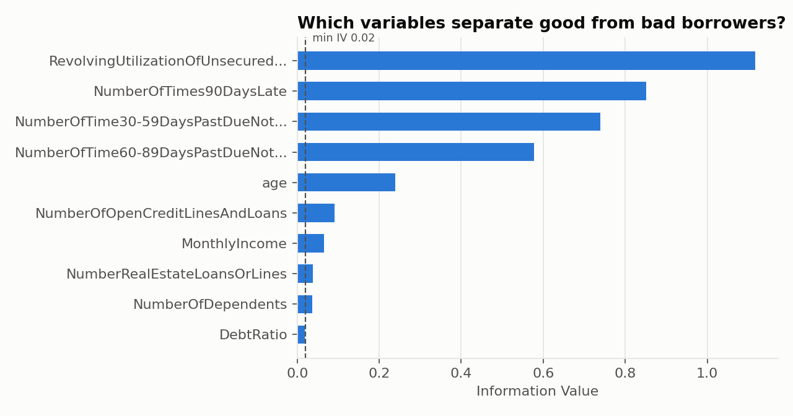
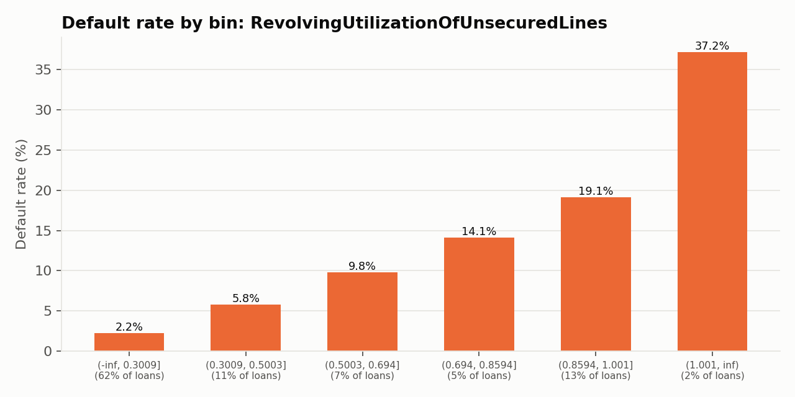
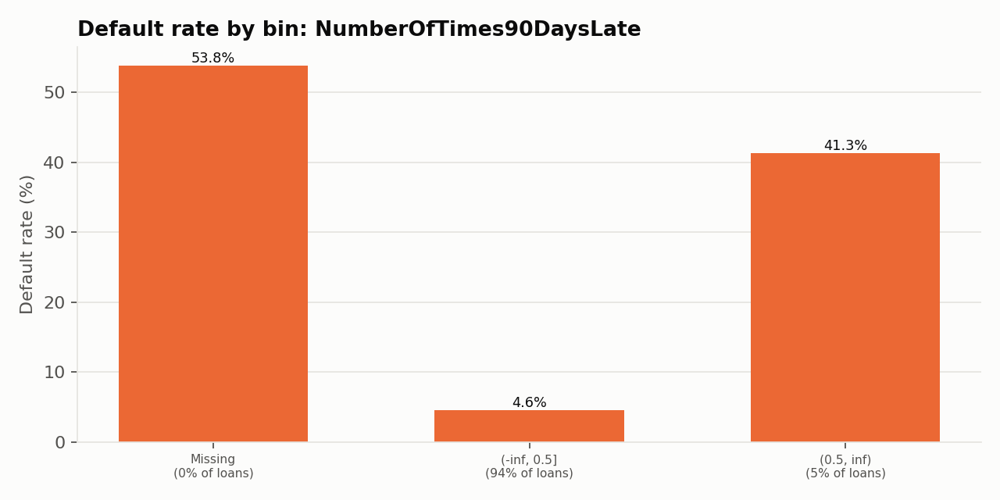
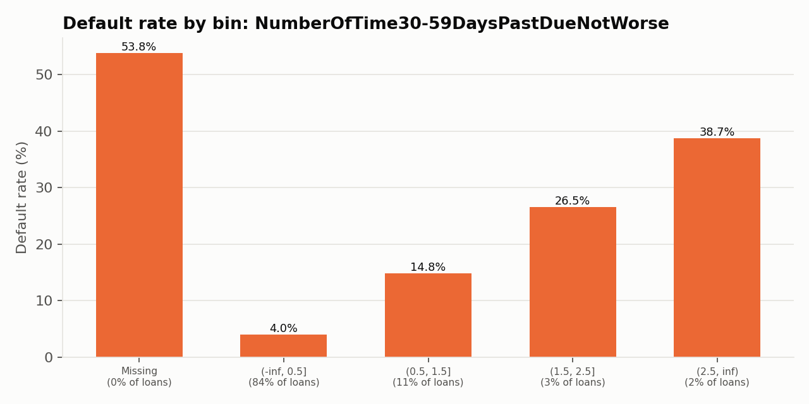
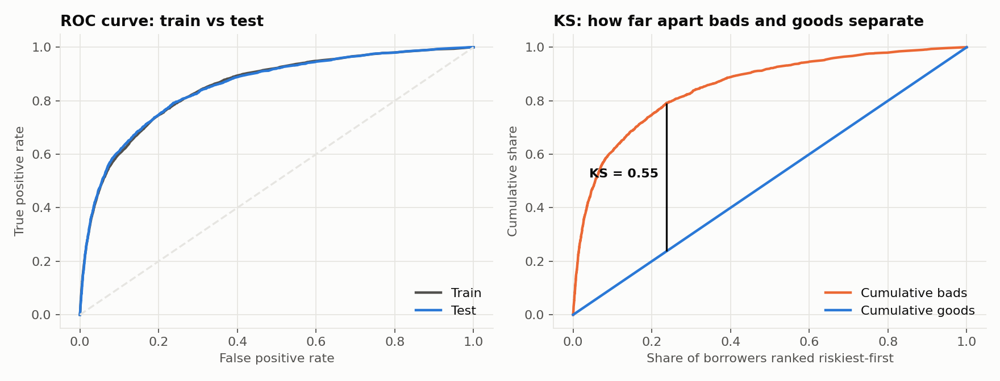
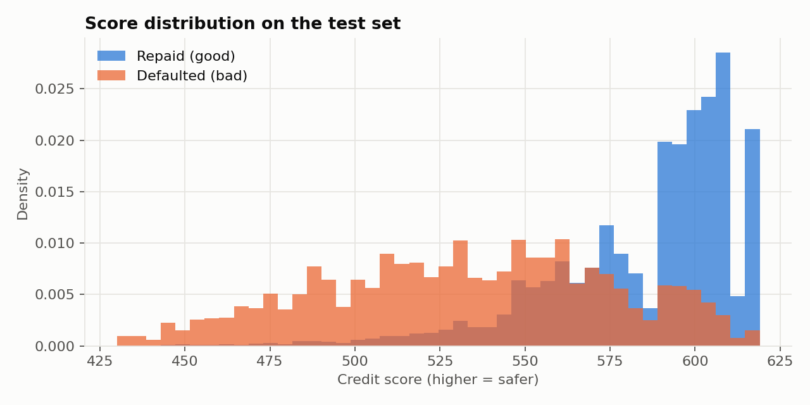
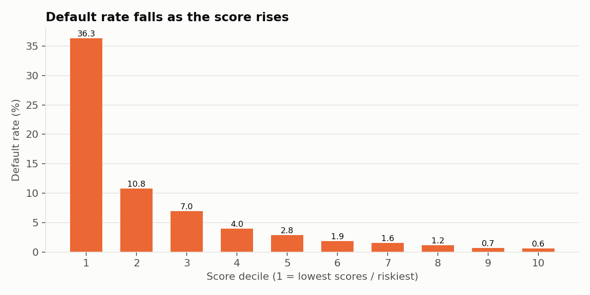
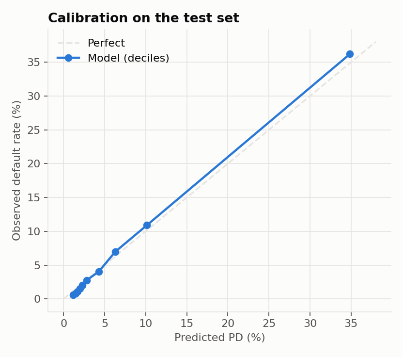
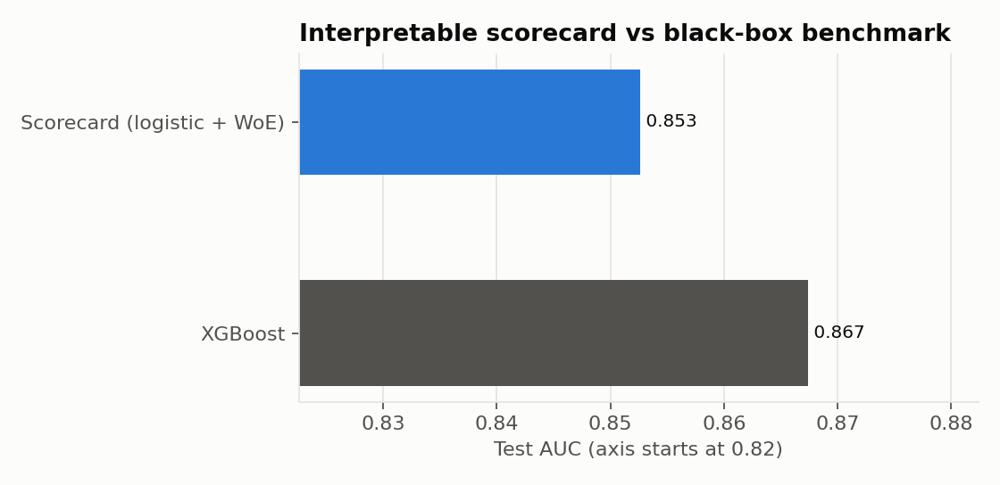

# Credit Risk Scorecard: Probability of Default model

An end-to-end **application scorecard** that estimates the probability a borrower becomes 90+ days past due within
2 years, then converts it into an interpretable points-based credit score (600 points at 50:1 odds, +20 points
doubles the odds), the way retail lenders build them.

Built with Python, pandas and scikit-learn. Binning, Weight of Evidence, scorecard scaling and PSI are implemented
from scratch in [`src/`](src) and covered by unit tests.

## Why this project

Lenders must explain every decline, so the industry standard is **logistic regression on WoE-binned variables**
rather than a black box. This project builds that pipeline properly and benchmarks it against gradient boosting to
quantify what interpretability costs.

## Results

<!-- RESULTS:START -->
**Data:** Give Me Some Credit (Kaggle) | **149,999** borrowers | default rate **6.7%** | 70/30 stratified split

| Metric (test set) | Value |
|---|---|
| AUC | **0.853** (95% CI 0.845 to 0.860) |
| KS | **0.55** |
| Gini | **0.71** |
| Train AUC (overfitting gap) | 0.852 (0.000) |
| XGBoost benchmark AUC | 0.867 |
| Score PSI, train vs test | 0.0003 (< 0.10 = stable) |
| Score range | 415 to 619 |

The interpretable scorecard gives up 0.015 AUC while staying fully explainable.
Variables in the final model (7): RevolvingUtilizationOfUnsecuredLines, NumberOfTimes90DaysLate, NumberOfTime30-59DaysPastDueNotWorse, NumberOfTime60-89DaysPastDueNotWorse, age, MonthlyIncome, NumberOfDependents.











Full tables: [`reports/results.md`](reports/results.md), [`reports/scorecard_points.csv`](reports/scorecard_points.csv).
<!-- RESULTS:END -->

## Approach

| Step | What | Why |
|---|---|---|
| 1. Clean | Drop invalid ages; treat 96/98 delinquency codes as missing; no outlier capping | Codes are placeholders, not counts; binning neutralises outliers |
| 2. Split | 70/30 stratified, **before** any fitting | Bins, WoE and coefficients learned on train only, so no leakage |
| 3. Bin | Decision-tree cut-points, monotonic bad rate, own bin for Missing | Explainable, robust to outliers, treats missingness as information |
| 4. WoE / IV | `WoE = ln(%good / %bad)`; IV ranks variables | Puts every variable on the same log-odds scale |
| 5. Select | IV >= 0.02; drop one of any pair with correlation > 0.75 | Removes noise and collinearity |
| 6. Model | Logistic regression on WoE; auto-drop any variable with a wrong-sign coefficient | Transparent; sign checks catch collinearity |
| 7. Evaluate | AUC, KS, Gini, bootstrap CI, train-vs-test gap, calibration deciles | Ranking power, overfitting, and PD accuracy |
| 8. Scale | `Score = Offset + Factor * ln(odds_good)`; points per bin | Loan officers can score by adding integers |
| 9. Stability | PSI on the score and every variable | Tells you when the population has drifted |
| 10. Benchmark | Same split, gradient boosting | Shows the accuracy cost of transparency |
| 11. Business | Approval-rate vs bad-rate table by cut-off | Turns a score into a decision |

The walkthrough notebook ([`notebooks/01_scorecard_walkthrough.ipynb`](notebooks/01_scorecard_walkthrough.ipynb))
explains each step in plain English, including a WoE bin calculated by hand and one applicant scored by hand.

## Run it

```bash
python -m venv venv && source venv/bin/activate        # Windows: venv\Scripts\activate
pip install -r requirements.txt

# put Kaggle's cs-training.csv in data/  (see data/README.md)
python -m src.train --data data/cs-training.csv --out reports
python -m src.render_docs          # fills the Results section above and docs/
python -m pytest -q                # unit tests
jupyter notebook notebooks/01_scorecard_walkthrough.ipynb
```

## Repo layout

```
src/data.py          loading, cleaning rules (logged), stratified split
src/binning.py       WoEBinner: supervised monotonic binning, WoE, IV
src/scorecard.py     selection, logistic fit with sign check, points scaling, scoring
src/metrics.py       AUC, KS, Gini, PSI, calibration, bands, cut-off table, bootstrap CI
src/train.py         end-to-end pipeline -> reports/
src/plots.py         figures
src/make_synthetic.py  synthetic stand-in dataset for testing
tests/               unit tests (WoE, IV, scaling, PSI, KS/AUC, cleaning, end to end)
reports/             figures, tables, metrics.json (generated)
```

## Limitations (and what I would do next)

* **Reject inference:** only approved borrowers have outcomes, so the model is trained on a biased population.
* **No out-of-time validation:** a single snapshot; in production monitor PSI monthly and run a challenger.
* **Fairness and regulation:** age is a strong predictor here, but its use in lending decisions is restricted in many jurisdictions.
* **Decision cut-offs** should use profit and loss per loan, not default rate alone.
* **Next:** add LGD and EAD to get Expected Loss = PD x LGD x EAD, and serve the points table through a small API or Streamlit app.

## Data

Kaggle *Give Me Some Credit* (150,000 borrowers). Not redistributed here; see [`data/README.md`](data/README.md).
